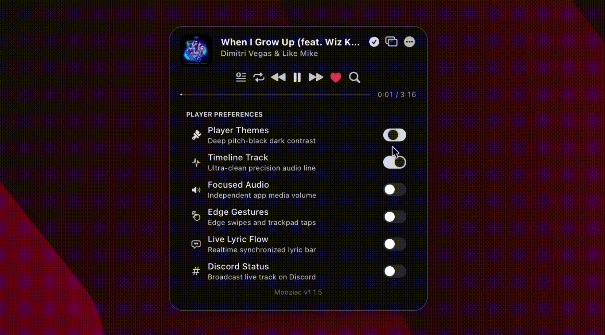

<h1 align="center">Mooziac — The Native YouTube &amp; YouTube Music Player for Mac</h1>

<p align="center">
  <b>The lightweight, native macOS desktop player for YouTube Videos, YouTube Music &amp; local audio.</b><br>
  Stream YouTube Music in your menu bar, watch 4K YouTube videos with Apple VideoToolbox GPU acceleration, skip sponsorships with SponsorBlock, and control volume with invisible trackpad edge gestures — with zero battery-draining Chromium bloat.
</p>

<p align="center">
  <a href="https://mooziac.pages.dev">
    
  </a>
</p>

<p align="center">
  <a href="https://mooziac.pages.dev"></a>
  <a href="https://mooziac.pages.dev"></a>
  <a href="https://github.com/shirkeharsh/mooziac/releases/latest"></a>
  <a href="https://github.com/shirkeharsh/mooziac/stargazers"></a>
  <a href="https://github.com/shirkeharsh/mooziac/releases/latest"></a>
  <a href="https://github.com/shirkeharsh/mooziac/releases/latest"></a>
  <a href="#privacy-first-architecture"></a>
  <a href="LICENSE"></a>
</p>

<p align="center">
  <a href="https://github.com/shirkeharsh/mooziac/releases/latest/download/Mooziac.dmg">
    
  </a>
  &nbsp;&nbsp;
  <a href="https://github.com/shirkeharsh/mooziac/releases/latest/download/Mooziac.zip">
    
  </a>
  &nbsp;&nbsp;
  <a href="https://mooziac.pages.dev">
    
  </a>
</p>

<br>

<p align="center">
  <b>Mooziac is the ultimate native YouTube for Mac and YouTube Music for Mac client built specifically for macOS.</b><br>
  Say goodbye to laggy browser tabs and 1GB+ Electron apps. Mooziac delivers an instant menu bar music player, a 4K hardware-accelerated YouTube video window, an invisible trackpad edge volume slider, real-time synchronized lyrics HUD, and zero battery drain.
</p>

---

## See Mooziac in Action

<p align="center">
  
  <br>
  <sub><i>Interactive player preferences, themes, live audio waveforms, and native macOS menu bar playback controls.</i></sub>
</p>

---

## Why Mooziac?

Most desktop players are heavy Electron wrappers that bundle a full Chromium browser, devouring system resources and draining laptop battery life. Mooziac was built from scratch in **pure native Swift and AppKit** with zero third-party runtime dependencies, delivering the fastest **YouTube for Mac** and **YouTube Music for Mac** experience.

| Feature | Mooziac (Native Swift) | Official YouTube Web (Chrome/Safari) | Electron Wrappers (YTM Desktop, etc.) |
| :--- | :---: | :---: | :---: |
| **Technology** | **100% Native Swift & AppKit** | Heavy Browser Tab | Heavy Chromium + Node.js |
| **YouTube for Mac (Video)** | **Native 4K GPU Decode (Apple VideoToolbox)** | High CPU in Browser | Laggy Electron / High CPU |
| **YouTube Music for Mac** | **Discreet macOS Menu Bar Player** | Trapped in browser tab | Takes up full desktop space |
| **Distraction-Free & SponsorBlock**| **Built-in clean UI & auto-skip** | Requires browser extensions | Inconsistent / third-party plugins |
| **RAM Footprint** | **< 50 MB** | 400 MB – 1+ GB | 500 MB – 1.2 GB |
| **Battery & Thermal Efficiency** | **Optimized for Apple Silicon (Cool & Quiet)**| High battery drain | Heavy battery drain & warm chassis |
| **Trackpad Edge Volume Control** | **Yes (1mm edge with Taptic haptics)** | No | No |
| **Synchronized Lyrics HUD** | **Line-by-line real-time LRC** | Basic / Unsynced | None |
| **Offline Local Audio** | **FLAC, MP3, WAV, AAC, M4A, ALAC** | None (Cloud only) | None |
| **Background Media Keys** | **Native macOS Integration (NowPlaying)** | Requires browser focus | Inconsistent |
| **Discord Rich Presence** | **Native Unix socket (0 dependencies)** | None | Third-party plugin required |
| **Telemetry & Privacy** | **100% Local-First (Zero tracking SDKs)** | Extensive Google tracking | Varies |

---

## Native macOS Features: YouTube Video Player, Trackpad Gestures & Audio Engine

<table>
  <tr>
    <td width="50%" valign="top">
      <h4>4K YouTube Video Player &amp; Hardware Acceleration</h4>
      <p>Watch full YouTube videos in a dedicated native window with zero battery-draining CPU churn.</p>
      <ul>
        <li><b>VideoToolbox GPU Decode:</b> Hardware-accelerated VP9 and H.264 video decoding directly via Apple Silicon and Intel Metal GPUs.</li>
        <li><b>Distraction-Free Viewing:</b> Built-in clutter filtering, distraction-free focus mode, and automatic SponsorBlock segment skipping directly inside the native engine.</li>
        <li><b>Native Fullscreen:</b> Seamless edge-to-edge macOS fullscreen toggle via <code>F</code> key, double-click, or native window controls.</li>
      </ul>
    </td>
    <td width="50%" valign="top">
      <h4>Invisible Trackpad Volume Slider</h4>
      <p>Turn the rightmost 1mm border of your MacBook trackpad into an invisible hardware volume dial.</p>
      <ul>
        <li><b>1mm Border Edge:</b> Slide along the outer bezel for fine-grained system volume adjustment across music and video.</li>
        <li><b>Tactile Taptic Engine:</b> Real physical haptic ticks as volume levels increment or decrement.</li>
        <li><b>Continuous Level Tracking:</b> Lift finger and resume adjusting smoothly from current level without snapping back.</li>
      </ul>
    </td>
  </tr>
  <tr>
    <td width="50%" valign="top">
      <h4>Floating Synchronized Lyrics HUD</h4>
      <p>Sing along with real-time, line-by-line synchronized LRC lyrics right beneath your menu bar.</p>
      <ul>
        <li><b>Line-by-Line LRC:</b> Powered by LRCLib and native YouTube Music synced endpoints.</li>
        <li><b>Non-Intrusive HUD:</b> Floats discreetly without taking window focus or blocking your workspace.</li>
        <li><b>Instant Local Cache:</b> Stored in SQLite for zero-latency retrieval on repeat listens.</li>
      </ul>
    </td>
    <td width="50%" valign="top">
      <h4>Dual Audio Engine (Cloud + Local Hi-Res)</h4>
      <p>Stream your cloud favorites or play lossless offline libraries in one seamless unified queue.</p>
      <ul>
        <li><b>YouTube Music Bridge:</b> Direct access to your cloud playlists, liked songs, and history.</li>
        <li><b>Lossless Hi-Res:</b> Pure <code>AVFoundation</code> playback supporting FLAC, ALAC, WAV, MP3, AAC, and M4A.</li>
        <li><b>Built-in Downloader:</b> Integrated <code>yt-dlp</code> pipeline with automatic tag and artwork embedding.</li>
      </ul>
    </td>
  </tr>
  <tr>
    <td width="50%" valign="top">
      <h4>Interactive Waveform & Adaptive Glow</h4>
      <p>Dynamic ambient interface that harmonizes with your music and desktop wallpaper.</p>
      <ul>
        <li><b>Live Audio Visualizer:</b> Interactive waveform scrub bar with real-time seeking.</li>
        <li><b>Adaptive Palette:</b> Real-time color sampling from active album artwork.</li>
        <li><b>Curated Themes:</b> OLED Pitch Black, Crystal Glass, and Liquid Fluid visual styles.</li>
      </ul>
    </td>
    <td width="50%" valign="top">
      <h4>Native Discord Rich Presence</h4>
      <p>Broadcast your now-playing status without third-party bloat or background daemons.</p>
      <ul>
        <li><b>Native Unix Socket IPC:</b> Direct connection with zero Node.js or Python runtime overhead.</li>
        <li><b>Rich Status Card:</b> Displays active song title, artist, album art, and live elapsed timestamps.</li>
        <li><b>Auto-Pause Sync:</b> Updates status in real time when playback is paused or resumed.</li>
      </ul>
    </td>
  </tr>
  <tr>
    <td width="100%" colspan="2" valign="top">
      <h4>100% Local & Privacy-First</h4>
      <p>Architected with strict privacy principles — your listening data and video activity remain strictly on your Mac.</p>
      <ul>
        <li><b>Zero Telemetry:</b> No analytics SDKs, trackers, beacons, or crash reporters phoning home.</li>
        <li><b>Local SQLite3:</b> History, likes, and cached playlists stay entirely in your local storage.</li>
        <li><b>Sandboxed WebKit:</b> Credentials remain safely inside Apple's official <code>WKWebsiteDataStore</code>.</li>
      </ul>
    </td>
  </tr>
</table>

---

## Gestures & Shortcuts

### Trackpad MultiTouch Gestures

| Gesture | Trackpad Region | Action |
| :--- | :--- | :--- |
| **Edge Slide** | Far-right 1mm border | Smooth volume adjustment with tactile haptics |
| **Double Tap** | Bottom-right corner | Next Track |
| **Triple Tap** | Bottom-right corner | Previous Track |
| **Double Tap** | Bottom-left corner | Play / Pause Toggle |
| **Scroll** | Over Menu Bar Icon | Fast Volume Stepping |

### Keyboard Shortcuts

#### Music Player Mode

| Shortcut | Action |
| :--- | :--- |
| `Space` | Play / Pause |
| `Cmd + Right Arrow` | Next Track |
| `Cmd + Left Arrow` | Previous Track |
| `L` | Like / Unlike Song |
| `Cmd + R` | Reload Web Engine |
| `Cmd + Q` | Quit Mooziac |

#### YouTube Video Mode

| Shortcut | Action |
| :--- | :--- |
| `F` | Toggle macOS Native Fullscreen |
| `Space` / `K` | Play / Pause Video |
| `J` / `L` | Seek 10s Backward / Forward |
| `M` | Mute / Unmute Audio |
| `C` | Toggle Closed Captions / Subtitles |
| `[` / `]` | Decrease / Increase Playback Speed |
| `Cmd + Shift + F` | Toggle Distraction-Free Focus Mode |
| `Cmd + Shift + S` | Toggle SponsorBlock Auto-Skip |
| `Cmd + Shift + C` | Copy Video URL with Timestamp |
| `Esc` | Exit Fullscreen |

---

## Installation

### Option 1: Homebrew (Recommended)

Install directly via the official Homebrew tap:

```bash
brew install shirkeharsh/tap/mooziac
```

To update in the future:
```bash
brew upgrade --cask mooziac
```

### Option 2: Direct Download

1. Download [`Mooziac.dmg`](https://github.com/shirkeharsh/mooziac/releases/latest/download/Mooziac.dmg) or [`Mooziac.zip`](https://github.com/shirkeharsh/mooziac/releases/latest/download/Mooziac.zip).
2. Open `Mooziac.dmg` and drag **Mooziac** into your **Applications** folder.
3. Launch Mooziac from Spotlight (`Cmd + Space`) or Launchpad.

> [!NOTE]
> **macOS Gatekeeper:** Because Mooziac is distributed directly outside the Mac App Store:
> - If macOS prompts that the app cannot be verified, go to **System Settings > Privacy & Security** and click **Open Anyway**.
> - Or run this one-line command in Terminal:
>   ```bash
>   xattr -cr /Applications/Mooziac.app
>   ```

---

## Building from Source

### Prerequisites
- macOS 13.0 (Ventura) or later
- Xcode 15+ or Xcode Command Line Tools (`xcode-select --install`)
- Swift 5.9+ toolchain

```bash
# Clone repository
git clone https://github.com/shirkeharsh/mooziac.git
cd mooziac

# Run unit tests
swift test --parallel

# Build and launch debug app locally
./build_app.sh

# Build universal release binary & DMG package
./build_app.sh --release-only
```

---

## Architecture and Project Structure

Mooziac is architected into modular Swift components using native macOS system frameworks:

```
Mooziac/
├── Package.swift                         # SPM manifest (macOS 13+, Swift 5.9)
├── Mooziac.entitlements                  # Hardened Runtime security entitlements
├── build_app.sh                          # Universal build & packaging pipeline
├── Sources/Mooziac/                      # Main application target
│   ├── App/                              # Application lifecycle, AppDelegate, background media keys
│   ├── Audio/                            # CoreAudio volume hooks, AVFoundation audio player
│   ├── Core/                             # Central coordinators, NowPlaying, StatusItemManager
│   ├── Input/                            # MultiTouch gesture engine & global keyboard shortcuts
│   ├── Managers/                         # Local SQLite3, YTMClient, synced lyrics, yt-dlp downloader
│   ├── Models/                           # State representations, playlist records, audio configs
│   ├── Views/                            # Dynamic Island player UI, waveform, floating lyrics HUD
│   ├── Web/                              # Sandboxed WebKit bridge for YouTube Music streaming
│   └── YouTube/                          # Native YouTube video player subsystem
│       ├── Core/                         # MainVideoWindowController, VideoPlayerCoordinator
│       ├── Database/                     # YouTubeDatabaseManager local watch history & likes
│       ├── Extensions/                   # WebExtensionHost, WebExtensionManager
│       ├── Input/                        # KeyboardShortcutHandler for fullscreen & playback
│       ├── Models/                       # VideoQuality, VideoPlaybackState, PlayerTheme
│       ├── Services/                     # YouTubeDownloadService via yt-dlp
│       ├── Settings/                     # YouTubeSettings (clutter filters, distraction-free)
│       ├── Views/                        # MooziacHeaderBarView, FloatingHUD, DownloadSheet
│       └── Web/                          # YouTubeWebView, QualityManager, SponsorBlock, Highlight
└── Tests/MooziacTests/                   # Parallelized unit test suite
    ├── DownloadManagerURLTests.swift     # URL & YouTube shorts ID extraction tests
    ├── DownloadQueuePersistenceTests.swift# Download queue SQLite/JSON persistence tests
    ├── MooziacTests.swift                # Hotkeys, seek modifiers, and playlist advancing tests
    ├── PlaylistFileCodecTests.swift      # JSON & M3U8 import/export codec tests
    ├── PlaylistReorderTests.swift        # Drag-and-drop playlist reordering tests
    ├── SyncedLyricsParserTests.swift     # LRC line-by-line timestamp parser tests
    ├── URLFilterTests.swift              # Link recognition & streaming domain tests
    ├── YouTubeVideoTests.swift           # Video quality, thermal defaults, state, & settings tests
    └── YTMClientSearchTests.swift        # YouTube Music search endpoint client tests
```

---

## Playlist File Import & Export

In the Playlists view, use the **+** button to import an M3U/M3U8 or JSON playlist file. Right-click a playlist and choose **Export Playlist** to save it as M3U8 or JSON. Import creates a new playlist and references the local file paths in the playlist; it does not copy or move audio files. Relative paths are resolved from the playlist file's folder. Missing local files remain as references and can resolve when they become available. Online entries in imported playlists and non-local entries during export are skipped.

Mooziac's JSON playlist format is versioned and uses UTF-8:

```json
{
  "version": 1,
  "name": "Road Trip",
  "tracks": [
    { "path": "/Users/me/Music/song.m4a", "title": "Song", "artist": "Artist" }
  ]
}
```

---

## Frequently Asked Questions (FAQ)

<details>
<summary><b>Is there an official YouTube or YouTube Music app for Mac?</b></summary>
<p>No, Google does not provide an official native desktop app for YouTube or YouTube Music on macOS. Mac users are normally forced to keep heavy browser tabs open or run bloated Electron desktop wrappers that consume hundreds of megabytes of RAM. <b>Mooziac is built specifically to bridge this gap:</b> a 100% native Swift & AppKit application that delivers a dedicated 4K hardware-accelerated YouTube video player and a discreet YouTube Music menu bar player with minimal battery and system impact.</p>
</details>

<details>
<summary><b>Can I watch regular YouTube videos in Mooziac or only listen to music?</b></summary>
<p>You can do both! In addition to the menu bar music player, Mooziac features a dedicated native YouTube video player window. It includes 4K hardware acceleration via VideoToolbox, distraction-free clean playback, automatic SponsorBlock skipping, and trackpad edge volume gestures. You can switch between music and video modes anytime from the menu bar context menu.</p>
</details>

<details>
<summary><b>How does Mooziac optimize YouTube playback for MacBook battery life?</b></summary>
<p>Instead of launching a heavyweight Chromium or Electron browser engine, Mooziac utilizes Apple's native <code>VideoToolbox</code> framework and WebKit GPU acceleration. Hardware-decodable video codecs (VP9, AV1, and H.264) are processed directly by Apple Silicon and Intel Metal media engines, drastically reducing CPU usage, preventing fan spin-up, and keeping your MacBook cool and efficient.</p>
</details>

<details>
<summary><b>Does Mooziac support SponsorBlock and distraction-free viewing for YouTube on Mac?</b></summary>
<p>Yes. Mooziac integrates native SponsorBlock segment skipping directly into the playback coordinator. It automatically detects and skips sponsor segments, intro animations, interaction reminders, and non-music portions. You can toggle SponsorBlock on or off anytime with <code>Cmd + Shift + S</code>, or toggle distraction-free mode with <code>Cmd + Shift + F</code>.</p>
</details>

<details>
<summary><b>Is Mooziac compatible with Apple Silicon M1, M2, M3, M4, and M5 Macs?</b></summary>
<p>Yes. Mooziac is distributed as a Universal 2 macOS application. It runs 100% natively on Apple Silicon (M1, M2, M3, M4, M5, Pro, Max, and Ultra) as well as Intel 64-bit processors on macOS 13.0 (Ventura), macOS 14 (Sonoma), macOS 15 (Sequoia), and newer.</p>
</details>

<details>
<summary><b>Is Mooziac free and open-source?</b></summary>
<p>Yes. Mooziac is 100% free and open-source software distributed under the permissive MIT License. There are no subscriptions, paywalls, or hidden tracking.</p>
</details>

<details>
<summary><b>Does Mooziac require a YouTube Music Premium account?</b></summary>
<p>No. Mooziac works seamlessly with both free YouTube Music accounts and YouTube Music Premium accounts. Free users get access to the full standard catalog, while Premium users enjoy higher-bitrate audio streams.</p>
</details>

<details>
<summary><b>How is Mooziac different from the official YouTube Music web or desktop apps?</b></summary>
<p>Official and third-party desktop wrappers are built on Electron or Chromium, often consuming 500 MB to 1.2 GB of RAM and impacting laptop battery life. Mooziac is engineered in pure native Swift and AppKit with zero third-party runtime dependencies, consuming minimal system resources while running directly in the macOS menu bar.</p>
</details>

<details>
<summary><b>How does the MacBook trackpad volume gesture work?</b></summary>
<p>Mooziac captures multi-touch events along the rightmost 1mm border of your MacBook trackpad. Gliding your finger along that outer edge smoothly adjusts system volume while triggering physical tactile clicks through the Mac's built-in Taptic Engine. Intelligent palm rejection prevents accidental triggers during typing.</p>
</details>

<details>
<summary><b>Does Mooziac collect any personal data or listening history?</b></summary>
<p>None. Mooziac features a zero-telemetry architecture: no analytics beacons, no tracking SDKs, and no crash reporters. Your listening history, playlists, and liked songs are saved solely in a local SQLite database on your Mac, and credentials remain sandboxed in Apple's official <code>WKWebsiteDataStore</code>.</p>
</details>

<details>
<summary><b>How do I install or update Mooziac using Homebrew?</b></summary>
<p>Install via the official tap with one command:
<pre><code>brew install shirkeharsh/tap/mooziac</code></pre>
To upgrade in the future, run:
<pre><code>brew upgrade --cask mooziac</code></pre>
</p>
</details>

<details>
<summary><b>Can I play local audio files (FLAC, MP3, WAV) offline?</b></summary>
<p>Yes. Mooziac features a dual audio engine: alongside YouTube Music streaming, it includes a native AVFoundation offline player supporting FLAC, ALAC, WAV, MP3, AAC, and M4A, complete with album artwork and integrated offline caching.</p>
</details>

---

## Support & Community

If you find Mooziac useful, please consider **starring the repository** — it helps more Mac users discover native, lightweight open-source software!

[](https://star-history.com/#shirkeharsh/mooziac&Date)

- **Found a bug?** [Open an issue](https://github.com/shirkeharsh/mooziac/issues)
- **Have a feature idea?** [Submit a feature request](https://github.com/shirkeharsh/mooziac/issues/new)
- **Official Website:** [mooziac.pages.dev](https://mooziac.pages.dev)

---

## License & Disclaimer

- **License:** Distributed under the [MIT License](LICENSE). Copyright (c) 2026 ThreeTen.
- **Disclaimer:** YouTube Music is a trademark of Google LLC. Mooziac is an independent open-source project and is not affiliated with, authorized, or endorsed by Google LLC.
