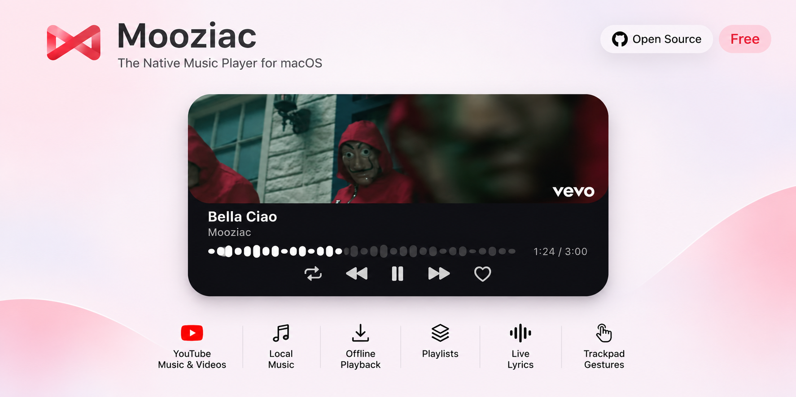
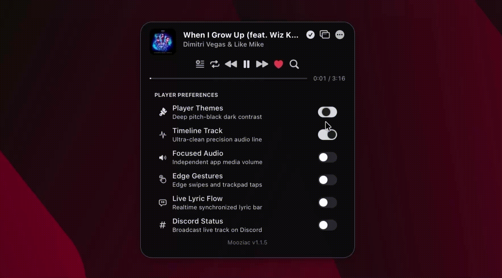
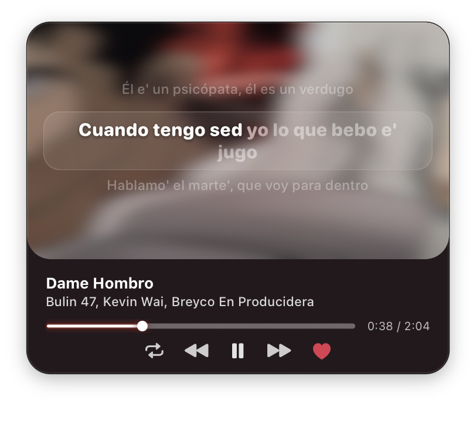
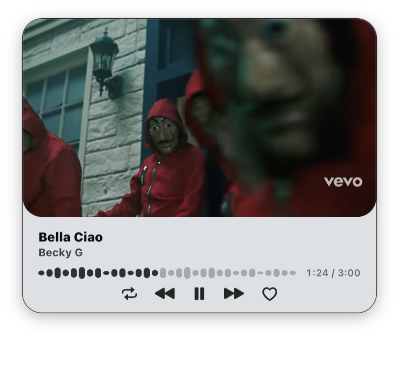
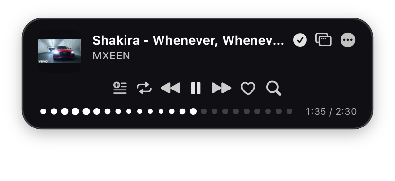
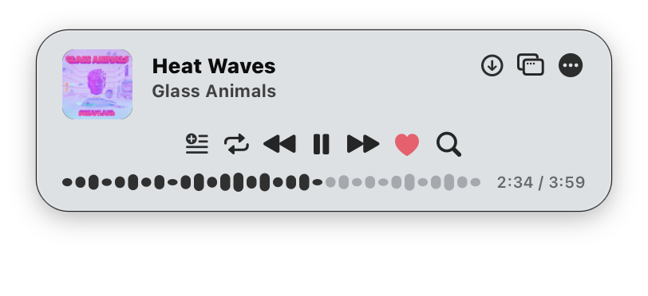
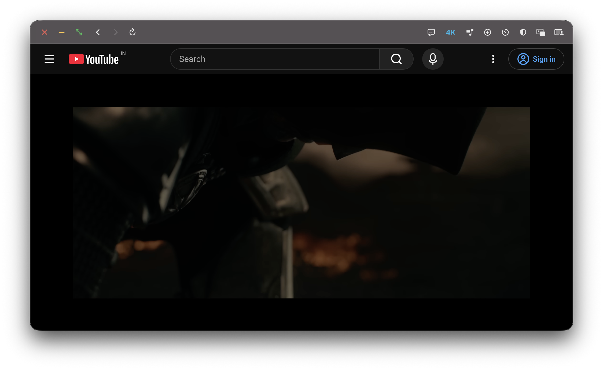
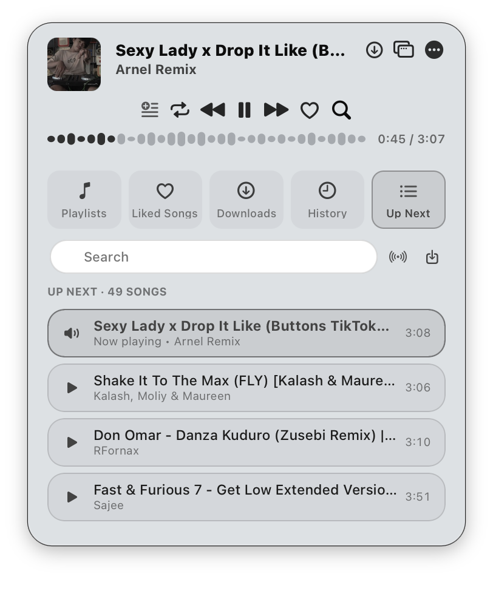

<div align="center">

<a href="https://mooziac.pages.dev">
  
</a>

# Mooziac

**The native desktop YouTube Music & 4K video client for macOS. Swift + AppKit, SponsorBlock, zero Electron.**

<p align="center">
  <a href="https://github.com/shirkeharsh/mooziac/releases/latest"></a>
  <a href="https://github.com/shirkeharsh/mooziac/releases/latest"></a>
  <a href="https://github.com/shirkeharsh/mooziac/stargazers"></a>
  <a href="https://mooziac.pages.dev"></a>
  
  
  
  <a href="LICENSE"></a>
</p>

<p align="center">
  <a href="https://github.com/shirkeharsh/mooziac/releases/latest/download/Mooziac.dmg">
    
  </a>
  &nbsp;
  <a href="https://github.com/shirkeharsh/mooziac/releases/latest/download/Mooziac.zip">
    
  </a>
</p>

**Mooziac** delivers a native desktop home for YouTube Music and 4K YouTube videos without the battery drain or RAM footprint of Chromium and Electron wrappers. Built in pure Swift and AppKit with direct hardware decoding via Apple VideoToolbox, live 3D synchronized lyrics, an invisible 1mm trackpad edge volume slider, and native SponsorBlock ad-skipping.

</div>

---

## See Mooziac in Action

<p align="center">
  
  <br>
  <sub><i>Interactive player preferences, themes, live audio waveforms, and native macOS menu bar playback controls.</i></sub>
</p>

---

## Screenshots

<table width="100%">
  <tr>
    <td width="50%" align="center" valign="middle">
      
    </td>
    <td width="50%" align="center" valign="middle">
      
    </td>
  </tr>
  <tr>
    <td width="50%" align="center" valign="middle">
      
    </td>
    <td width="50%" align="center" valign="middle">
      
    </td>
  </tr>
  <tr>
    <td width="50%" align="center" valign="middle">
      
    </td>
    <td width="50%" align="center" valign="middle">
      
    </td>
  </tr>
</table>

---

## Features

<table>
<tr>
<td width="50%" valign="top">

**Listening & Playback**

- Ad-free streaming straight from YouTube Music endpoints
- Discreet Dynamic Island player tucked into macOS status bar
- Lossless offline local playback: FLAC, ALAC, WAV, MP3, AAC, M4A
- Loudness leveling and gapless track transitions
- Built-in yt-dlp downloader with automatic tagging and artwork embedding
- Interactive waveform scrub bar with real-time seeking

</td>
<td width="50%" valign="top">

**3D Lyrics & Hero Mode**

- Real-time line-by-line synchronized LRC lyrics via LRCLib & YouTube
- 3D Dynamic Lyrics Stage with perspective tilt and active line illumination
- Gaussian blurred ambient artwork background
- Auto-hiding playback controls during idle listening
- Floating non-intrusive lyrics HUD beneath the menu bar
- SQLite local caching for zero-latency retrieval

</td>
</tr>
<tr>
<td valign="top">

**4K YouTube Video Player**

- Dedicated native window with Apple VideoToolbox GPU acceleration
- Hardware decode for VP9, AV1, and H.264
- Built-in SponsorBlock: automatically skips sponsors and intros
- Distraction-free clean focus mode
- Native macOS edge-to-edge fullscreen toggle (`F` key) and PiP
- Instant slash command video search (`/ query`)

</td>
<td valign="top">

**Trackpad Gestures & Controls**

- Invisible 1mm outer border trackpad slider with tactile Taptic ticks
- MultiTouch corner taps: double-tap bottom-right for next track
- Native macOS NowPlaying system integration and media keys
- Configurable global keyboard shortcuts with in-app toggle
- Fast volume stepping by scrolling over the menu bar status icon

</td>
</tr>
<tr>
<td valign="top">

**Library & Queue**

- Cloud playlists, liked songs, and listening history
- Drag-and-drop playlist reordering and queue management
- Import and export M3U, M3U8, and versioned JSON playlists
- Instant live search that previews tracks as you type
- Direct shuffle, repeat one, and repeat all modes

</td>
<td valign="top">

**Native Architecture & Privacy**

- Pure Swift 5.9 and AppKit with zero third-party runtime dependencies
- Under 50 MB RAM footprint (compared to 1 GB+ for Electron apps)
- Zero telemetry: no analytics SDKs, trackers, or crash reporters
- Credentials isolated inside Apple's sandboxed WKWebsiteDataStore
- Native Discord Rich Presence via Unix domain socket (zero dependencies)

</td>
</tr>
</table>

---

## Why Mooziac?

Most desktop players are heavy Electron wrappers that bundle a full Chromium browser, devouring system resources and draining laptop battery life. Mooziac was built from scratch in **pure native Swift and AppKit** with zero third-party runtime dependencies, delivering the fastest **YouTube for Mac** and **YouTube Music for Mac** experience.

| Feature | Mooziac (Native Swift) | Web & Electron Wrappers |
| :--- | :--- | :--- |
| **Architecture** | **100% Native Swift & AppKit** | Heavy Chromium + Node.js |
| **YouTube 4K Video** | **Hardware GPU Decode (VideoToolbox)** | High CPU in Browser / Electron |
| **YouTube Music** | **Discreet Menu Bar Dynamic Island** | Full desktop window or pinned tab |
| **SponsorBlock** | **Native built-in auto-skip** | Inconsistent browser extensions |
| **RAM Footprint** | **< 50 MB** | 500 MB – 1.2+ GB |
| **Battery Life** | **Optimized for Apple Silicon** | Heavy drain & warm laptop chassis |
| **Volume Control** | **Invisible 1mm Trackpad Edge + Haptics** | None |
| **Synchronized Lyrics** | **Real-time 3D Dynamic Lyrics Stage** | None or basic unsynced text |
| **Offline Audio** | **Lossless FLAC, WAV, MP3, AAC, M4A** | Cloud only |
| **Media Keys** | **Native macOS NowPlaying integration** | Requires active browser focus |
| **Discord Status** | **Native Unix socket (0 dependencies)** | Third-party plugin required |
| **Privacy & Telemetry** | **100% Local-First (Zero tracking SDKs)** | Extensive Google tracking |

---

## Download & Install

<p align="center">
  <a href="https://github.com/shirkeharsh/mooziac/releases/latest">
    
  </a>
</p>

| Platform | Format | Notes |
| :--- | :--- | :--- |
| macOS 13+ (Apple Silicon) | `.dmg` / `.zip` | Universal binary natively compiled for Apple M1 through M5 |
| macOS 13+ (Intel) | `.dmg` / `.zip` | Universal binary natively compiled for 64-bit Intel Macs |
| Homebrew Cask | CLI | Official tap: `brew install shirkeharsh/tap/mooziac` |

### Installation Steps

1. Download [`Mooziac.dmg`](https://github.com/shirkeharsh/mooziac/releases/latest/download/Mooziac.dmg) or [`Mooziac.zip`](https://github.com/shirkeharsh/mooziac/releases/latest/download/Mooziac.zip).
2. Open `Mooziac.dmg` and drag **Mooziac** into your **Applications** folder.
3. Launch Mooziac from Spotlight (`Cmd + Space`).

> **macOS Gatekeeper Note:** Because Mooziac is distributed outside the Mac App Store, if macOS prompts that the developer cannot be verified on first launch, either Right-Click `Mooziac.app` and choose **Open**, or run this command in Terminal:
> ```bash
> xattr -cr /Applications/Mooziac.app
> ```

---

## Shortcuts & Gestures

### Trackpad MultiTouch Gestures

| Gesture & Region | Action |
| :--- | :--- |
| **Edge Slide** (Far-right 1mm border) | Smooth volume adjustment with tactile haptics |
| **Double Tap** (Bottom-right corner) | Next Track |
| **Triple Tap** (Bottom-right corner) | Previous Track |
| **Double Tap** (Bottom-left corner) | Play / Pause Toggle |
| **Scroll** (Over Menu Bar Icon) | Fast Volume Stepping |

### Keyboard Shortcuts

#### Global System-Wide Shortcuts
Can be enabled or disabled at any time from **Quick Controls** (right-click the menu bar status icon).

| Shortcut | Action |
| :--- | :--- |
| `Control + Option + Space` or `Cmd + Shift + Space` | Play / Pause |
| `Control + Option + Right Arrow` or `Cmd + Shift + Right Arrow` | Next Track (Music) / Seek +10s (Video) |
| `Control + Option + Left Arrow` or `Cmd + Shift + Left Arrow` | Previous Track (Music) / Seek -10s (Video) |
| `Control + Option + L` or `Cmd + Shift + L` | Like Song |

#### Music Player Mode (In-App)

| Shortcut | Action |
| :--- | :--- |
| `Space` | Play / Pause |
| `Cmd + Right Arrow` | Next Track |
| `Cmd + Left Arrow` | Previous Track |
| `L` | Like / Unlike Song |
| `Cmd + R` | Reload Web Engine |
| `Cmd + Q` | Quit Mooziac |

#### YouTube Video Mode

| Shortcut | Action |
| :--- | :--- |
| `F` | Toggle macOS Native Fullscreen |
| `Space` / `K` | Play / Pause Video |
| `J` / `L` | Seek 10s Backward / Forward |
| `M` | Mute / Unmute Audio |
| `C` | Toggle Closed Captions / Subtitles |
| `[` / `]` | Decrease / Increase Playback Speed |
| `Cmd + Shift + S` | Toggle SponsorBlock Auto-Skip |
| `Cmd + Shift + F` | Toggle Distraction-Free Focus Mode |
| `Cmd + Shift + C` | Copy Video URL with Timestamp |
| `Esc` | Exit Fullscreen |

---

## Building from Source

### Prerequisites
- macOS 13.0 (Ventura) or later
- Xcode 15+ or Xcode Command Line Tools (`xcode-select --install`)
- Swift 5.9+ toolchain

```bash
# Clone repository
git clone https://github.com/shirkeharsh/mooziac.git
cd mooziac

# Run unit tests
swift test --parallel

# Build and launch debug app locally
./build_app.sh

# Build universal release binary & DMG package
./build_app.sh --release-only
```

---

## Architecture and Project Structure

Mooziac is architected into modular Swift components using native macOS system frameworks:

```
Mooziac/
├── Package.swift                         # SPM manifest (macOS 13+, Swift 5.9)
├── Mooziac.entitlements                  # Hardened Runtime security entitlements
├── build_app.sh                          # Universal build & packaging pipeline
├── Sources/Mooziac/                      # Main application target
│   ├── App/                              # Application lifecycle, AppDelegate, background media keys
│   ├── Audio/                            # CoreAudio volume hooks, AVFoundation audio player
│   ├── Core/                             # Central coordinators, NowPlaying, StatusItemManager
│   ├── Input/                            # MultiTouch gesture engine & global keyboard shortcuts
│   ├── Managers/                         # Local SQLite3, YTMClient, synced lyrics, yt-dlp downloader
│   ├── Models/                           # State representations, playlist records, audio configs
│   ├── Views/                            # Dynamic Island player UI, waveform, floating lyrics HUD
│   ├── Web/                              # Sandboxed WebKit bridge for YouTube Music streaming
│   └── YouTube/                          # Native YouTube video player subsystem
│       ├── Core/                         # MainVideoWindowController, VideoPlayerCoordinator
│       ├── Database/                     # YouTubeDatabaseManager local watch history & likes
│       ├── Extensions/                   # WebExtensionHost, WebExtensionManager
│       ├── Input/                        # KeyboardShortcutHandler for fullscreen & playback
│       ├── Models/                       # VideoQuality, VideoPlaybackState, PlayerTheme
│       ├── Services/                     # YouTubeDownloadService via yt-dlp
│       ├── Settings/                     # YouTubeSettings (clutter filters, distraction-free)
│       ├── Views/                        # MooziacHeaderBarView, FloatingHUD, DownloadSheet
│       └── Web/                          # YouTubeWebView, QualityManager, SponsorBlock, Highlight
└── Tests/MooziacTests/                   # Parallelized unit test suite
    ├── DownloadManagerURLTests.swift     # URL & YouTube shorts ID extraction tests
    ├── DownloadQueuePersistenceTests.swift# Download queue SQLite/JSON persistence tests
    ├── MooziacTests.swift                # Hotkeys, seek modifiers, and playlist advancing tests
    ├── PlaylistFileCodecTests.swift      # JSON & M3U8 import/export codec tests
    ├── PlaylistReorderTests.swift        # Drag-and-drop playlist reordering tests
    ├── SyncedLyricsParserTests.swift     # LRC line-by-line timestamp parser tests
    ├── URLFilterTests.swift              # Link recognition & streaming domain tests
    ├── YouTubeVideoTests.swift           # Video quality, thermal defaults, state, & settings tests
    └── YTMClientSearchTests.swift        # YouTube Music search endpoint client tests
```

---

## Frequently Asked Questions (FAQ)

<details>
<summary><b>Is there an official YouTube or YouTube Music app for Mac?</b></summary>
<p>No, Google does not provide an official native desktop app for YouTube or YouTube Music on macOS. Mac users are normally forced to keep heavy browser tabs open or run bloated Electron desktop wrappers that consume hundreds of megabytes of RAM. <b>Mooziac is built specifically to bridge this gap:</b> a 100% native Swift & AppKit application that delivers a dedicated 4K hardware-accelerated YouTube video player and a discreet YouTube Music menu bar player with minimal battery and system impact.</p>
</details>

<details>
<summary><b>Can I watch regular YouTube videos in Mooziac or only listen to music?</b></summary>
<p>You can do both! In addition to the menu bar music player, Mooziac features a dedicated native YouTube video player window. It includes 4K hardware acceleration via VideoToolbox, distraction-free clean playback, automatic SponsorBlock skipping, and trackpad edge volume gestures. You can switch between music and video modes anytime from the menu bar context menu.</p>
</details>

<details>
<summary><b>How does Mooziac optimize YouTube playback for MacBook battery life?</b></summary>
<p>Instead of launching a heavyweight Chromium or Electron browser engine, Mooziac utilizes Apple's native <code>VideoToolbox</code> framework and WebKit GPU acceleration. Hardware-decodable video codecs (VP9, AV1, and H.264) are processed directly by Apple Silicon and Intel Metal media engines, drastically reducing CPU usage, preventing fan spin-up, and keeping your MacBook cool and efficient.</p>
</details>

<details>
<summary><b>Does Mooziac support SponsorBlock and distraction-free viewing for YouTube on Mac?</b></summary>
<p>Yes. Mooziac integrates native SponsorBlock segment skipping directly into the playback coordinator. It automatically detects and skips sponsor segments, intro animations, interaction reminders, and non-music portions. You can toggle SponsorBlock on or off anytime with <code>Cmd + Shift + S</code>, or toggle distraction-free mode with <code>Cmd + Shift + F</code>.</p>
</details>

<details>
<summary><b>Is Mooziac compatible with Apple Silicon M1, M2, M3, M4, and M5 Macs?</b></summary>
<p>Yes. Mooziac is distributed as a Universal 2 macOS application. It runs 100% natively on Apple Silicon (M1, M2, M3, M4, M5, Pro, Max, and Ultra) as well as Intel 64-bit processors on macOS 13.0 (Ventura), macOS 14 (Sonoma), macOS 15 (Sequoia), and newer.</p>
</details>

<details>
<summary><b>Is Mooziac free and open-source?</b></summary>
<p>Yes. Mooziac is 100% free and open-source software distributed under the permissive MIT License. There are no subscriptions, paywalls, or hidden tracking.</p>
</details>

<details>
<summary><b>Does Mooziac require a YouTube Music Premium account?</b></summary>
<p>No. Mooziac works seamlessly with both free YouTube Music accounts and YouTube Music Premium accounts. Free users get access to the full standard catalog, while Premium users enjoy higher-bitrate audio streams.</p>
</details>

<details>
<summary><b>How is Mooziac different from the official YouTube Music web or desktop apps?</b></summary>
<p>Official and third-party desktop wrappers are built on Electron or Chromium, often consuming 500 MB to 1.2 GB of RAM and impacting laptop battery life. Mooziac is engineered in pure native Swift and AppKit with zero third-party runtime dependencies, consuming minimal system resources while running directly in the macOS menu bar.</p>
</details>

<details>
<summary><b>How does the MacBook trackpad volume gesture work?</b></summary>
<p>Mooziac captures multi-touch events along the rightmost 1mm border of your MacBook trackpad. Gliding your finger along that outer edge smoothly adjusts system volume while triggering physical tactile clicks through the Mac's built-in Taptic Engine. Intelligent palm rejection prevents accidental triggers during typing.</p>
</details>

<details>
<summary><b>Does Mooziac collect any personal data or listening history?</b></summary>
<p>None. Mooziac features a zero-telemetry architecture: no analytics beacons, no tracking SDKs, and no crash reporters. Your listening history, playlists, and liked songs are saved solely in a local SQLite database on your Mac, and credentials remain sandboxed in Apple's official <code>WKWebsiteDataStore</code>.</p>
</details>

<details>
<summary><b>How do I install or update Mooziac using Homebrew?</b></summary>
<p>Install via the official tap with one command:
<pre><code>brew install shirkeharsh/tap/mooziac</code></pre>
To upgrade in the future, run:
<pre><code>brew upgrade --cask mooziac</code></pre>
</p>
</details>

<details>
<summary><b>Can I play local audio files (FLAC, MP3, WAV) offline?</b></summary>
<p>Yes. Mooziac features a dual audio engine: alongside YouTube Music streaming, it includes a native AVFoundation offline player supporting FLAC, ALAC, WAV, MP3, AAC, and M4A, complete with album artwork and integrated offline caching.</p>
</details>

---

## Support & Community

If you find Mooziac useful, please consider **starring the repository** — it helps more Mac users discover native, lightweight open-source software!

[](https://star-history.com/#shirkeharsh/mooziac&Date)

- **Found a bug?** [Open an issue](https://github.com/shirkeharsh/mooziac/issues)
- **Have a feature idea?** [Submit a feature request](https://github.com/shirkeharsh/mooziac/issues/new)
- **Official Website:** [mooziac.pages.dev](https://mooziac.pages.dev)

---

## License & Disclaimer

- **License:** Distributed under the [MIT License](LICENSE). Copyright (c) 2026 ThreeTen.
- **Disclaimer:** YouTube Music is a trademark of Google LLC. Mooziac is an independent open-source project and is not affiliated with, authorized, or endorsed by Google LLC.
